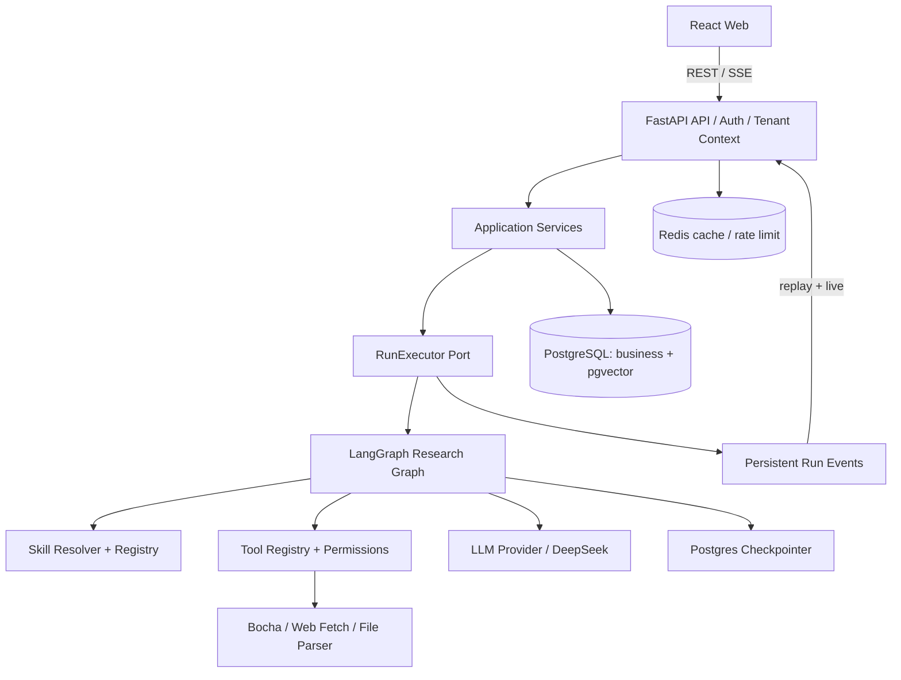
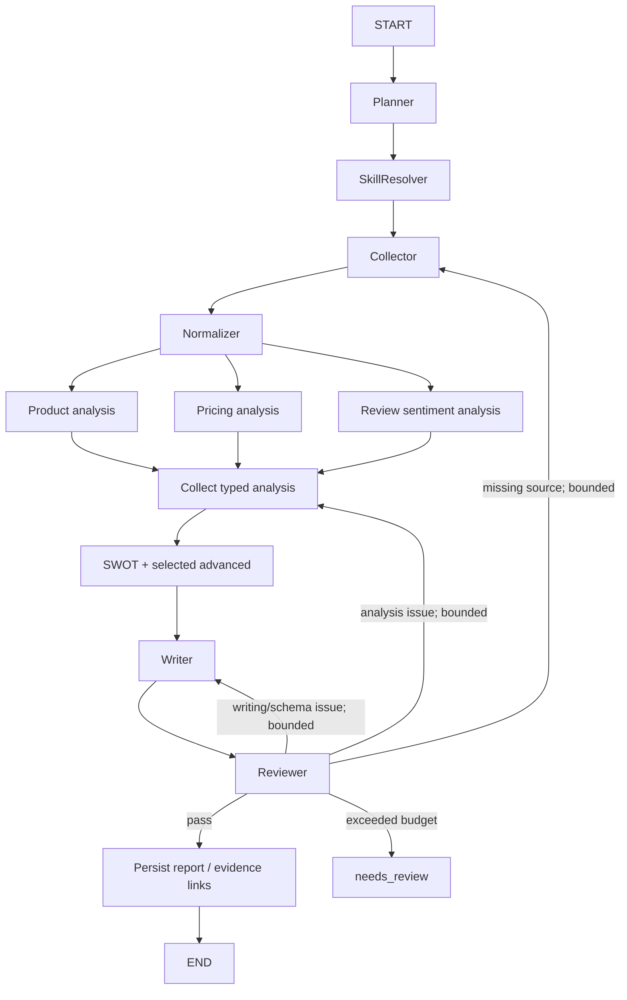

# Spyglass — 技术设计文档（TECHNICAL）

> 该文档是 MVP 的可执行架构约定。业务需求见 `PRD.md`，页面和原图映射见 `DESIGN.md`，Codex 规则见 `AGENTS.md`。所示 JSON、SQL、Python 为**协议/实现示例**，实施时补足完整定义、异常处理和测试。

## 1. 技术栈与架构原则

| 层 | 选择 | 说明 |
|---|---|---|
| Web | React 19、TypeScript、Vite、TailwindCSS、Zustand、React Router | 前端应用 |
| UI 辅助 | ReactFlow、ECharts（可按需使用 D3）、Framer Motion、Lucide | 流程图/报告图表/动效/图标 |
| 数据请求 | TanStack Query + OpenAPI 生成的 TS 类型 | 服务端状态与类型同步；Zustand 管本地 UI 状态 |
| HTTP | FastAPI + Pydantic v2 | 认证、租户、业务 API、SSE |
| Agent | LangGraph Python | Agent Graph、Checkpoint、状态和中断 |
| DB | PostgreSQL + pgvector、SQLAlchemy 2、Alembic | 业务数据与向量；迁移显式管理 |
| Redis | Redis | 缓存/限流；后续可接可靠队列和事件传输 |
| AI Provider | DeepSeek API，经自有适配层 | 接口隔离、可替换、记录模型版本 |
| Search Provider | Bocha API，经 Tool 适配层 | 搜索结果规范化、去重、来源记录 |
| 测试 | pytest、Vitest、React Testing Library、Playwright | 单元、集成与端到端 |
| 部署 | Docker Compose，明确镜像版本和迁移指令 | MVP 单实例部署；未来拆分 API/Worker |

架构原则：模块化单体；业务 API 不直接承载 Graph 编排细节；Graph 不直接处理 HTTP/认证；Model/Tool/Storage 通过接口隔离；每个可追踪执行具有不可混用的 `tenant_id`、`user_id`、`project_id`、`thread_id` 和 `run_id`。



### 1.1 责任分层

- **API**：参数/鉴权、Tenant 解析、Pydantic、分页、SSE 传递；不写 Prompt 或 Tool 的业务逻辑。
- **Application**：项目/会话/Run/报告/权限/事务/取消及版本管理。
- **Domain**：Competitor、Evidence、Claim、Report、Review、Skill 等业务协议和不变量。
- **Agent Runtime**：图构建、模型与工具循环、阶段转换、Checkpoint、人工中断、Retry 策略。
- **Infrastructure**：数据库仓储、Redis、模型、搜索、文件、向量适配器。
- **Frontend**：根据 API 和事件呈现状态；不得根据假计时器推测 Agent 的执行进度。

## 2. 仓库结构

```text
spyglass/
  apps/
    web/
      src/{app,layouts,pages,components,features,services,hooks,stores,types,styles}/
      public/
    api/
      app/
        api/v1/{auth,research,threads,runs,competitors,evidence,intelligence,reports,skills}.py
        core/{config,security,dependencies}.py
        application/{services,dto,ports}/
        domain/{entities,schemas,enums}/
        infrastructure/{database,repositories,cache,storage,providers}/
        agent/
          runtime/{graph,state,executor,lifecycle,routing}.py
          agents/{collector,analyst,writer,reviewer}.py
          skills/{registry,resolver,loader,validator}.py
          tools/{registry,permissions,search,fetch,extract,retrieval}.py
          {models,context,memory,hooks,tracing,evaluation}/
      alembic/
      tests/{unit,integration}/
  extensions/skills/{general_analysis,ecommerce,internet_product,hardware_iot,ai_llm,finance,product_capability,pricing_analysis,user_sentiment,swot_analysis,market_landscape,business_model,strategic_recommendation}/
  assets/references/               # 本文档包中 UI 原图；项目中按需复制
  docs/{PRD,TECHNICAL,DESIGN,AGENTS,prompt}.md
  tests/e2e/
  infra/docker/
  docker-compose.yml
  .env.example
  README.md
```

后续 Harness 模块只在需要时落地，不创建大量空类、未调用的 facade 或 TODO 模拟实现。

## 3. ID、隔离、认证和并发不变量

- ID 使用 UUID/ULID 等稳定全局唯一值，UI 展示 ID 和 DB 主键之间保持一一对应。
- `thread_id` 是 LangGraph Checkpointer 的 Thread 标识；`run_id` 是**一次执行**，不是 Thread；一个 Thread 允许串行多个 Runs。
- 所有用户资源在业务层和数据库层限定 Tenant。服务端根据认证主体 + `tenant_members` 决定当前 Tenant；**不信任客户端随意填写的 `tenant_id`**。
- 个人工作空间即 MVP 默认 Tenant。若使用 Cookie 认证，启用 HttpOnly/Secure/SameSite 策略和匹配的 CSRF 防护、CORS 白名单；密码使用安全哈希，登录限流，密钥只在后端。
- MVP 每个 `thread_id` 同时最多一个活动 Run：原子创建或 DB 唯一约束/锁保证；第二个请求返回可解释冲突或明确入队，不能交叉写入历史。同租户不同 Thread/用户的活动 Run 可并行，但 LocalExecutor 必须有有界容量。
- Run 创建接口接收 `Idempotency-Key`；对同一用户同一 Thread 的重复创建返回原 Run，不重复生成消息或执行有副作用工具。
- Run 生命周期与 HTTP/SSE 连接解耦；关闭页面不取消运行，只有明确取消命令才请求取消。
- 单实例 LocalRunExecutor 是 MVP 选择，不宣称跨进程强恢复；后续通过 `RunExecutor` port 切换 `QueueRunExecutor`，保持 API/事件协议稳定。

## 4. 技能注册与解析规范

### 4.1 分类及强制规则

- `scenario`：`general_analysis`、`ecommerce`、`internet_product`、`hardware_iot`、`ai_llm`、`finance`；一次运行**恰好一个**主场景，默认 general。
- `core`：`product_capability`、`pricing_analysis`、`user_sentiment`、`swot_analysis`；**始终全部执行**。SWOT 依赖前三项，缺少证据时标为 partial/insufficient_evidence。
- `advanced`：`market_landscape`、`business_model`、`strategic_recommendation`；由用户选择或 Planner 智能匹配。
- `internal`：采集、证据检索、标准化、质检/写作属于内部能力或工具，不纳入用户 13 Skill。

每次创建 Run 保存 `resolved_skills`（id、version、manifest checksum、选择来源 manual/auto/required）；运行期间不得因仓库文件被更新就默默改变既有配置。

### 4.2 Skill Manifest（Spyglass 自定义协议）

```yaml
id: user_sentiment
name: 用户评价分析
version: 0.1.0
kind: core
entrypoint: SKILL.md
applies_to: [analyst]
requires: [normalized_evidence]
allowed_tools: [evidence_search, knowledge_retrieval]
input_schema: ReviewAnalysisInput
output_schema: ReviewAnalysisResult
config_schema: ReviewAnalysisConfig
```

Registry 验证：唯一 ID、SemVer/版本、文件合法性、输入输出 Schema、声明工具是否在白名单、依赖是否可解析、必选 Skill 禁用保护。`SKILL.md` 包含专业指导与来源/输出约束，不包含真实密钥、不授予系统权限。加载顺序为元数据发现 → 按需读取内容 → 审核版本 → 注入相关 Agent 上下文。

### 4.3 分析产物依赖

```text
scenario context + normalized evidence
  ├─ product_capability ─┐
  ├─ pricing_analysis ───┼─> SWOT（再关联外部机会/威胁证据）
  └─ user_sentiment ─────┘
  └─ selected advanced skills ──> report writer
```

四项核心产物**各有 status、字段和 Evidence 引用**。扩展的场景维度由 Scenario 提供，不能在各行业目录复制相同四套算法。

## 5. Agent/Graph 协议

### 5.1 有责任边界的节点

| 节点 | 责任 | 结构化输出 |
|---|---|---|
| Planner | 解读需求、确定竞品、范围、深度、任务计划 | `ResearchPlan` |
| SkillResolver | 固定场景/四核心/增强 Skill 及其版本 | `ResolvedSkills` |
| Collector Agent | 搜索、读取合规资料、去重、采集并记录来源 | `Source[]`, `Evidence[]`、采集缺口 |
| Normalizer | 映射功能树、套餐、评价等结构化 Schema | `CompetitorProfile[]`、`ReviewSample[]` |
| Analyst Agent | 按 Skill 生成三项基础分析、SWOT 和增强结果 | `AnalysisBundle` / `Claim[]` |
| Writer Agent | 报告大纲、章节、表格、图表数据、Claim 映射 | `ReportDraft` |
| Reviewer Agent | Schema、真实性、来源关联、矛盾、遗漏与逻辑检查 | `ReviewResult` |

固定为四个专业 Agent（Collector、Analyst、Writer、Reviewer）；Planner/Resolver/Normalizer 是职责明确的编排或转换节点，不额外宣传成多个自治 Agent。



图中是**逻辑依赖图**；实际编写 LangGraph 时应避免多条未配置 reducer 的边同时覆盖同一 State 键。根据 2026-10-20 用户确认的性能要求，产品能力、定价、用户评价三个独立分析必须并发调用 LLM，使用独立输出键或 reducer 汇合；SWOT 在三项完成后执行，Writer 和 Reviewer 遵守真实数据依赖。Provider 必须有全局并发上限、单调用超时、Run 总时间预算及有限重试；取消/超时应终止未完成请求并显式记录 partial/needs_review/failed，不得以假进度掩盖延迟。Trace 记录各调用起止时间；测试验证实际并发重叠、并发上限及整轮截止时间。具体预算可配置，实际端到端耗时在 Slice 3–6 联调中测量，不预先承诺供应商响应时间。

### 5.2 State 和消息约束

```python
from typing import TypedDict

class ResearchState(TypedDict):
    tenant_id: str
    user_id: str
    project_id: str
    thread_id: str
    run_id: str
    user_request: str
    competitor_ids: list[str]
    research_mode: str
    resolved_skills: list[dict]       # frozen id/version/checksum
    plan_id: str | None
    evidence_ids: list[str]           # 引用；不将网页全文塞入 checkpoint
    profile_ids: list[str]
    analysis_refs: dict[str, str]     # 每个 Skill 对应持久化产物 ID
    report_draft_id: str | None
    review_result: dict | None
    review_count: int
    status: str
```

业务字段采用 Pydantic Schema 作为节点边界；内部发送包含 `run_id`、`producer`、`schema_version`、`payload`、`evidence_ids` 的结构化事件/产物。大文本/文件保存在 Storage；State 保存受控摘要和引用。Graph Context 注入经服务端验证的身份、配置、取消令牌及工具权限，而不是从不可信模型输出读取身份。

### 5.3 质检反馈机制

`ReviewResult` 必须包含 `passed`、`issues[{type,severity,target,claim_id?,evidence_id?,description,repair_request}]`、`next_target`、`review_count` 和 `status`。类型至少有 `missing_evidence`、`unsupported_claim`、`contradiction`、`schema_error`、`outdated_source`。返回 Collector/Analyst/Writer 时按目标增量返工；记录修复前后的 Evidence/Claim 差异。有限重试后进入 `needs_review` 而非宣称完成。测试需要人工提供可复现的缺证据 fixture，验证真正改变产物。

### 5.4 Human-in-the-loop / 范围变化

应用层保存 ScopeChange/ApprovalRequest；Graph 在明确定义的检查点通过 `interrupt`/`Command(resume=...)` 协调恢复。节点重进时副作用工具须具备幂等保护。MVP 只保证阶段边界应用范围变更，不承诺任意时刻无损修改运行中节点。用户编辑报告需写入新版本，不得直接覆盖模型正在写的内容。

## 6. 证据、竞品知识与用户评价 Schema

- `Source`：id、tenant_id、origin_type（web/upload/survey/interview）、canonical_url?、title、publisher?、published_at?、collected_at、content_hash、content_location、access_scope、license/permission note；不可信网页只作为数据，不能覆盖系统指令。
- `Evidence`：id、source_id、tenant_id、quote/excerpt、locator（页码/段落/URL fragment 等）、observed_at、validity_status；去重与版本关联。
- `CompetitorProfile`：名称、官网?、定位?、功能树、套餐/币种/周期、受众、结构化字段来源、最后采集/验证时间；未知信息为空并解释。
- `Claim`：正文、type、competitor_ids、run_id、claim_status（supported/partial/unsupported/contradicted）、章节定位；`ClaimEvidence` 是多对多关联，保留支持/反驳关系。
- `ReportDraft`：有版本号的 sections[]（heading/paragraph/comparison_table/chart/evidence_block）、Claims 引用、数据图表 payload、缺失字段、整体状态；导出使用同一结构化内容。

### 6.1 Review sentiment 规范

评论级四分类：`positive / negative / neutral / mixed`。每条评论 `ReviewSample` 保存 `source_id`、`evidence_id`、`competitor_id`、原文或允许引用片段、发布时间?、采集时间、评论级分类、方面[]、去重指纹、分类置信度?、语言。方面对象包含 `aspect_key`、`opinion_span`、`sentiment`、`evidence_id`；跨场景可通过场景 Schema 添加物流、上下文能力等方面。

```json
{
  "overall_sentiment": "mixed",
  "aspects": [
    {"aspect_key": "code_completion", "opinion_span": "补全效果好", "sentiment": "positive", "evidence_id": "ev-example-1"},
    {"aspect_key": "pricing", "opinion_span": "价格偏高", "sentiment": "negative", "evidence_id": "ev-example-1"}
  ]
}
```

这是测试 fixture，不是真实评价。整体情感占比以**去重评论总数**为分母；方面情感占比以该方面已分类观点总数为分母。一条 mixed 评价整体只计一次；不能把置信度解释为评论真实性。聚合时附上样本量、采样/平台偏差、来源覆盖与不足提示；不凭空生成外部论坛评论。

### 6.2 报告事实与覆盖率

有证据覆盖率 = 至少关联 1 条**有效** Evidence 的事实性 Claim 数 ÷ 全部需要来源的事实性 Claim 数。它不等于事实准确率或来源可信度。价格必须注明币种、计费单位、采集/生效相关时间；产品“未发现支持证据”与“明确不支持”分开。时间序列不足时不渲染伪趋势。

## 7. 数据库设计（迁移必须落实）

MVP 至少建立：

| 表 | 核心字段/关系 |
|---|---|
| `users` | id、email(unique)、password_hash、status、created_at |
| `tenants` | id、name、type、created_at |
| `tenant_members` | tenant_id + user_id(unique)、role、status |
| `research_projects` | id、tenant_id、created_by、title、mode、scenario_skill_id、status、created_at |
| `threads` | id、tenant_id、project_id、created_by、title、created_at |
| `messages` | id、tenant_id、thread_id、run_id?、role、content_json、created_at、sequence |
| `runs` | id、tenant_id、project_id、thread_id、user_id、status、skills_snapshot_json、requested_at、started_at?、finished_at?、error_code?、usage_json、idempotency_key |
| `run_events` | id、tenant_id、run_id、seq、type、schema_version、payload_json、created_at；unique(run_id,seq) |
| `run_steps` | id、tenant_id、run_id、node、status、started_at、ended_at?、usage_json、artifact_refs |
| `tool_calls` | id、tenant_id、run_id、step_id、tool_name、args_redacted_json、result_ref、status、idempotency_key、usage_json |
| `skills` | id、kind、version、manifest_checksum、metadata_json、is_system_required |
| `skill_configs` | tenant_id、skill_id、enabled、config_json；禁止关闭四基础 |
| `competitors` | id、tenant_id、canonical_name、website?、profile_json、updated_at |
| `project_competitors` | project_id、competitor_id、tenant_id |
| `sources` | id、tenant_id、source_type、url?、title、published_at?、collected_at、content_hash、content_ref、metadata_json |
| `evidence` | id、tenant_id、source_id、excerpt、locator_json、validity_status、embedding?、created_at |
| `claims` | id、tenant_id、run_id、competitor_id?、statement、type、status、created_at |
| `claim_evidence` | tenant_id、claim_id、evidence_id、relation |
| `review_samples` | id、tenant_id、competitor_id、source_id、evidence_id、text_excerpt、sentiment、aspects_json、fingerprint、published_at? |
| `analysis_artifacts` | id、tenant_id、run_id、skill_id、skill_version、status、content_json、source_refs_json |
| `reports` | id、tenant_id、project_id、run_id、title、status、current_version_id? |
| `report_versions` | id、tenant_id、report_id、version、content_json、editor_type、editor_id?、created_at |
| `assets` | id、tenant_id、owner_id、filename、media_type、size、storage_ref、created_at |

- `tenant_id` 在高频业务表中显式存在，并用联合键/仓储校验避免跨租户外键链接；按 `(tenant_id, created_at)`、`(tenant_id, thread_id, sequence)`、`(tenant_id, run_id, seq)` 建索引。
- `runs` 对活跃状态建立与实现一致的单 Thread 并发约束；同一用户/Thread/幂等键重复请求去重。
- `run_events` 的递增 seq 由事务/行锁/可靠序列分配，绝不由前端本地计数代替。
- pgvector 仅在配置合法 embedding provider 且完成索引构建后开放语义检索；否则使用关键词/结构化检索并清晰标注降级。向量查询必须强制 Tenant 过滤。
- LangGraph 使用 PostgreSQL Checkpointer，持久化业务状态和 Graph State 分开；部署要运行 migration/checkpointer 初始化并检验。
- 文件数据存储可先使用经目录隔离的本地卷和 `assets` 元数据；业务层通过 Storage Port 使用，未来换 OSS/S3。文件下载与访问需鉴权，不能直接公开原始绝对路径。

## 8. Run 与 SSE 协议

### 8.1 生命周期

`pending → running → completed / failed / cancelled / needs_review`；在确有审批需求时使用 `waiting_approval`，取消过程中使用 `cancel_requested`。所有状态转移应由服务端校验和持久化，最终状态不可随意返回 running。Worker 崩溃的遗留任务需要明确的恢复/失败标记策略；LocalExecutor 不宣称提供分布式故障恢复。

### 8.2 RunExecutor port

```python
class RunExecutor(Protocol):
    async def submit(self, run_id: str) -> None: ...
    async def request_cancel(self, run_id: str) -> None: ...
    async def get_status(self, run_id: str) -> str: ...
```

MVP 实现有界、进程内 `LocalRunExecutor`；不能把 FastAPI `BackgroundTasks` 当成可靠队列。后续实现 `QueueRunExecutor` 时不改变上层 Run API。Graph 工具副作用（如写入 Source、报告导出等）使用 `run_id + tool_call_id + operation` 的幂等机制。

### 8.3 SSE 事件封装

```json
{
  "event_id": "evt-example",
  "schema_version": 1,
  "seq": 17,
  "run_id": "run-example",
  "thread_id": "thread-example",
  "type": "evidence.added",
  "timestamp": "2026-10-20T00:00:00Z",
  "payload": {"evidence_id": "ev-example", "source_id": "src-example"}
}
```

规范事件：`run.started`、`plan.updated`、`agent.started`、`agent.completed`、`tool.started`、`tool.completed`、`message.delta`、`evidence.added`、`report.updated`、`review.failed`、`run.interrupted`、`run.completed`、`run.failed`、`run.cancelled`。所有持久关键事件应先写 DB 再向订阅者可见；断线凭 `Last-Event-ID` / `after_seq` 重放，恢复后继续 live stream。实时逐 Token delta 可以选定明确的批量/持久化策略，但必须保证重连后的**最终消息正确**、不重复拼接。前端必须按 `event_id`/seq 去重。

SSE 使用 `GET /runs/{id}/events`，Run 创建使用单独 POST，天然适配浏览器 GET 订阅。后端要处理客户端断开和订阅取消，但不因此隐式取消业务 Run。

## 9. REST API v1（前后端共同遵守）

- 基础前缀 `/api/v1`；JSON 统一 `{data, meta?}` 或明确的 Pydantic 响应 Schema；错误统一 `{error:{code,message,details?,request_id}}`；支持分页和权限检查；API 按 OpenAPI 生成前端 TS 类型。
- 以下路由为**Spyglass 应用层拟定协议**，不是 LangGraph 框架原生端点。

| Method | Endpoint | 说明 |
|---|---|---|
| POST | `/auth/register` | 注册；创建默认个人 Tenant |
| POST | `/auth/login` | 登录；设置安全会话 |
| POST | `/auth/logout` | 登出；注销会话 |
| GET | `/users/me` | 当前账户与有效工作空间 |
| GET | `/skills` | 按 kind 查询、可用/必选/版本 |
| GET | `/skills/{skill_id}` | Skill 元信息/配置/说明 |
| PATCH | `/skills/{skill_id}/config` | 有权限的开关/配置；core 不可关闭 |
| POST | `/research` | 创建 Project |
| GET | `/research` | 列表、搜索、状态/分页 |
| GET/PATCH/DELETE | `/research/{project_id}` | 详情/更新/软删除或归档 |
| POST | `/threads` | 为 Project 创建 Thread |
| GET | `/threads/{thread_id}` | 详情 |
| GET | `/threads/{thread_id}/messages` | 消息历史 |
| POST | `/threads/{thread_id}/runs` | 创建 Run，`Idempotency-Key`，返回 run_id |
| GET | `/runs` | Run 列表/筛选 |
| GET | `/runs/{run_id}` | Run 状态、统计与关联 |
| GET (SSE) | `/runs/{run_id}/events` | `after_seq` / Last-Event-ID，回放 + 实时 |
| POST | `/runs/{run_id}/cancel` | 显式请求取消 |
| POST | `/runs/{run_id}/resume` | 仅允许有有效 pending interrupt 的恢复 |
| POST | `/runs/{run_id}/scope-changes` | 记录运行中范围变更请求 |
| GET | `/competitors` | 租户内竞品档案列表 |
| GET | `/competitors/{competitor_id}` | 概况/能力/套餐/评价/来源 |
| GET | `/evidence/{evidence_id}` | 查看证据及其可访问来源 |
| GET | `/intelligence` | 真实竞品动态、筛选与分页 |
| POST | `/intelligence/refresh` | 对授权竞品触发主动采集或更新 |
| GET | `/intelligence/summary` | 基于真实记录的指标 |
| GET | `/reports` | 报告列表 |
| GET | `/reports/{report_id}` | 当前报告/关联数据 |
| GET | `/reports/{report_id}/versions` | 版本历史 |
| PATCH | `/reports/{report_id}` | 乐观版本校验后创建人工编辑版本 |
| POST | `/reports/{report_id}/export` | MVP 支持 PDF；其他格式明确拒绝 |
| POST | `/assets` | 校验上传格式/大小/归属并返回资产 ID |

### 9.1 创建 Run 请求示例

```json
{
  "user_message": "比较 Cursor 与 Windsurf 的产品能力、定价和口碑",
  "competitor_ids": ["<existing-competitor-uuid>"],
  "competitor_names_to_add": ["Windsurf"],
  "mode": "standard",
  "scenario_skill_id": "ai_llm",
  "advanced_skill_ids": ["market_landscape"],
  "advanced_skill_selection": "manual"
}
```

后端校验枚举/竞品归属/数量/资源限制；自动补足四 core，锁定版本，原子持久化用户消息和 Run。`201 Created` 返回 `run_id`,`thread_id`,`status`,`events_url`。自动选择增强技能时 `advanced_skill_selection=auto`，Planner 必须记录选择理由及版本；不可通过客户端删掉核心技能。

### 9.2 报告和编辑

报告 API 返回稳定的结构化 `sections` + `claim_ids` + `chart_data`，前端按 block type 渲染。`PATCH` 必须带 `expected_version`，冲突返回 409 并提示刷新/比较；Agent 更新与用户编辑不能互相覆盖。PDF 导出从当前已持久化版本构建，不能把未保存的页面 DOM 当成事实来源。

## 10. 模型、工具及安全策略

- `ModelProvider` 封装 DeepSeek 的消息、工具调用、结构化输出、用量和错误响应；不向 Agent 内部泄漏供应商 SDK 细节；未知 usage 保留 null。
- `ToolRegistry` 保存工具 ID、Pydantic 参数 Schema、能力类型（read/write）、可访问源、审计和超时/重试策略；通过 Tenant/Run/Skill 权限决策后才能执行。
- `web_fetch` 必须限制 scheme、私网/回环/元数据服务地址、跳转目标、响应大小/类型、超时；尊重 robots、服务条款和授权；不接受任意本地路径或把网页 HTML 当系统 Prompt。
- 文件上传校验类型、大小、扩展名/内容一致性、存储路径、访问权限；展示 Markdown/HTML 时做安全清洗；外部 URL 添加安全跳转策略。
- Prompt/工具参数/Trace 存储时保护 Token、用户隐私、问卷与访谈记录；最小权限、可审计；不公开模型内部隐式推理。Trace 展示可解释的执行摘要、结构化产物及真实事件。
- 搜索/向量/缓存索引包含 Tenant 范围；跨 Tenant 不共享私有证据。公共网络资料复用也必须经过数据来源/访问许可判断。
- 具副作用的写工具采用幂等键，Graph 恢复/重试不得重复发外部请求或重复创建报告。

## 11. Context、Memory、Observability、Evaluation

**MVP**：上下文按预算组织，保留用户目标、已冻结 Skill/关键结论、来源引用；过长的采集正文切分并存储引用而非整段塞入消息。Checkpointer 保存 Thread/Graph State；业务表保存长期可查询的 Source、Competitor、Claim、Report。基础事件记录节点输入/输出摘要（脱敏）、工具调用、模型名、Prompt 版本、usage、耗时、状态及错误码。

**扩展接口**：`ContextManager` 可在后续加入摘要压缩、不同信息优先级和 Token 预算；`MemoryStore` 可增加跨 Thread 的长期记忆及检索；`TracingSink`、`HookRegistry`、`EvaluationRunner` 独立于业务路由。Memory 的归属以 Tenant/User 为边界，不能将用户隐私写入公共向量空间。

基本评测 fixture：真实权限隔离、缺失价格证据、错误 Schema、矛盾来源、用户评价 mixed、多方面情感、评论去重、SWOT 溯源、Reviewer 定向打回、重试幂等、SSE 断线重连、报告版本冲突、同时两 Thread 执行。

## 12. 运行、部署和未来迁移

MVP Docker Compose 服务可为 `web`、`api`、`postgres`（安装 pgvector）、`redis`；LocalExecutor 与 `api` 同进程，必须配置有界任务容量、进程退出处理、故障遗留 Run 检查及健康探针。Dockerfile 使用固定主版本/锁文件，密钥通过 `.env` 注入，提供 `.env.example`（无任何真实凭证）。所有 Schema 变更通过 Alembic，禁止启动时直接 `create_all` 替代生产迁移。

未来路径：API/Gateway → 持久队列 → 独立 Agent Workers → EventBus/SSE Gateway，保留 RunExecutor 和统一事件协议；随后支持 tenant-level 配额、正式成员管理/RBAC、MCP、Subagents、Hooks、Sandbox、CLI 和扩展插件。不要在 MVP 冒充已具备分布式强可靠性。

## 13. 技术验收清单

- [ ] 迁移可在干净数据库执行，租户/会话/Run/证据/报告之间外键有效。
- [ ] 编译后的 LangGraph 具备真实 Checkpointer，Node 输出按约定 Schema 交接。
- [ ] 四 core Skill 的产物始终可观察到结果或显式不足状态；场景与增强 Skill 的版本被 Run 冻结。
- [ ] 具证据缺失的 Fixture 能触发 Reviewer 路由返工，超过限制进入 needs_review。
- [ ] 断线重连用事件游标恢复，无最终消息重复拼接；Run 不绑定 SSE 连接。
- [ ] 同 Thread 并发冲突有原子保护；不同 Thread 不共享 State；跨 Tenant API/文件/向量/事件不可读。
- [ ] Token、模型调用、工具耗时和错误来自真实记录；没有模拟统计进入正常业务环境。
- [ ] 认证、上传、web_fetch SSRF、敏感信息脱敏和报告版本冲突均有测试。
